

# Mihon Together

### Read manga together with your friends

A multiplayer fork of [Mihon](https://github.com/mihonapp/mihon): everything Mihon does, plus friends, synced reading rooms, chats, rankings, reviews and in-reader translation.

## Download

Get the APK from the [releases page](https://github.com/berti12423/MihonTogether/releases/latest) or the [website](https://mihontogether.web.app/download). The app tells you when an update is out.

*Requires Android 8.0 or higher.*

## Screenshots

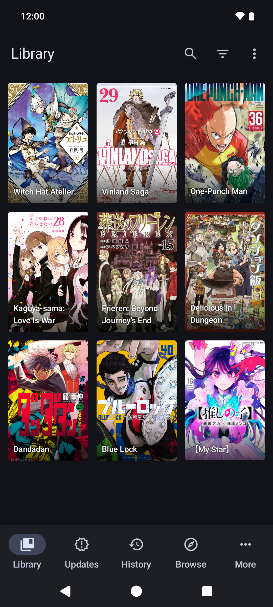 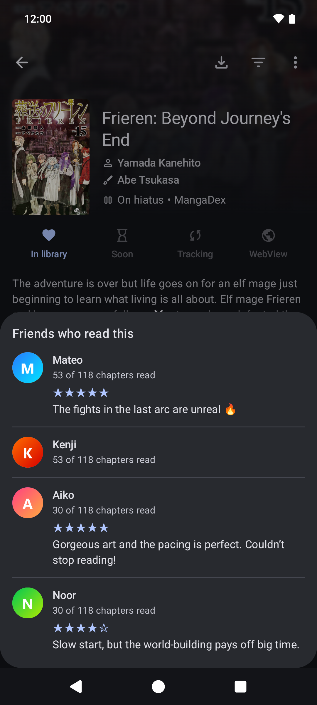 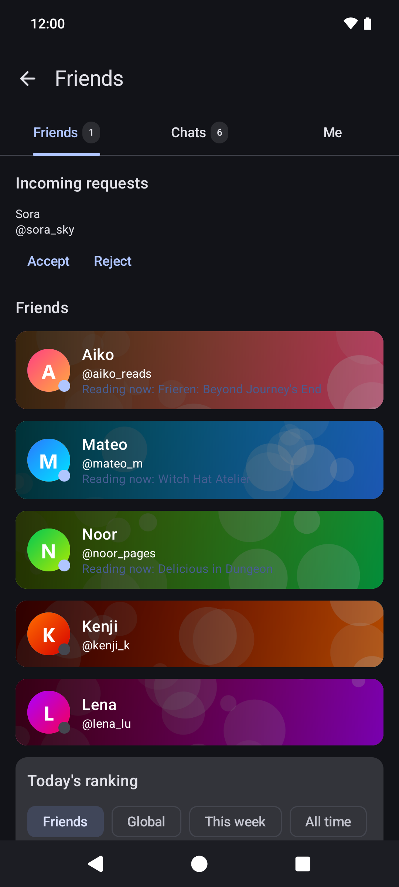 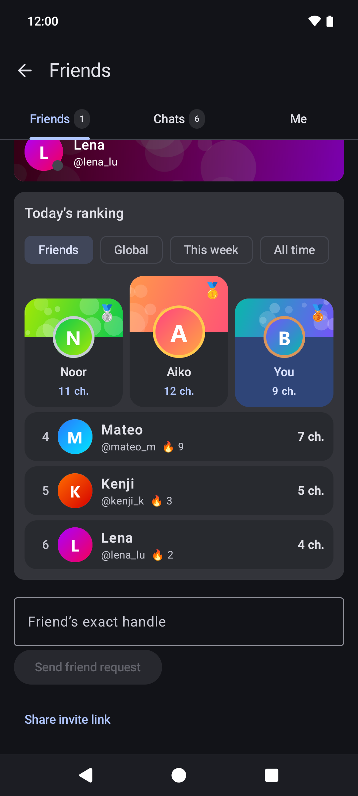

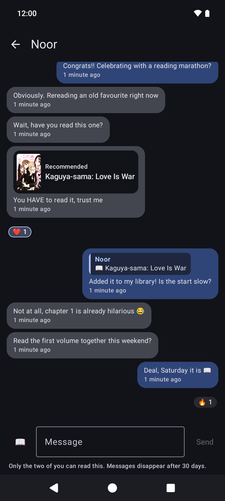 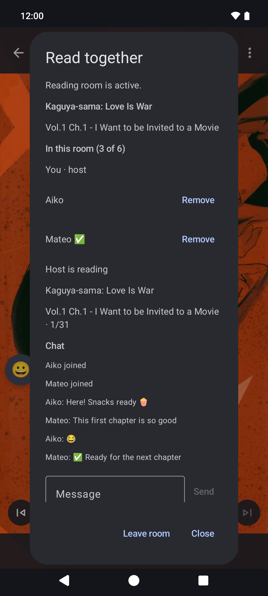 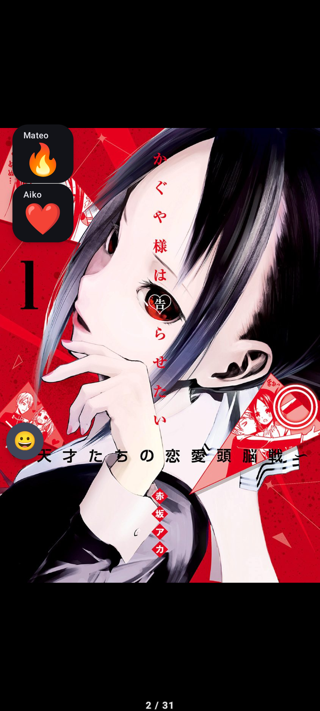 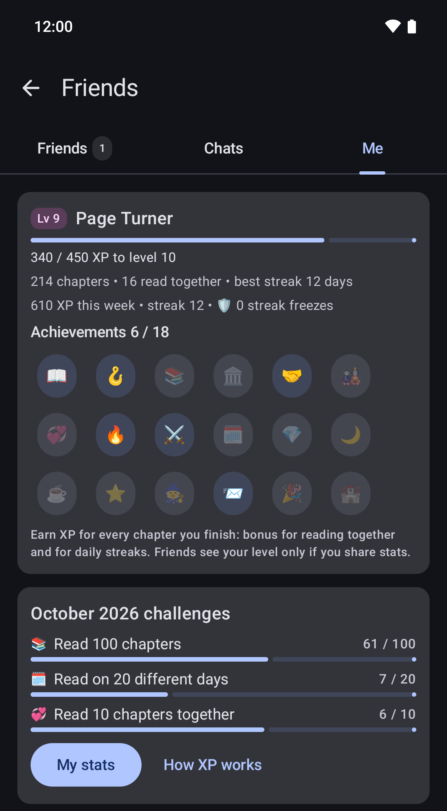

**On the web**

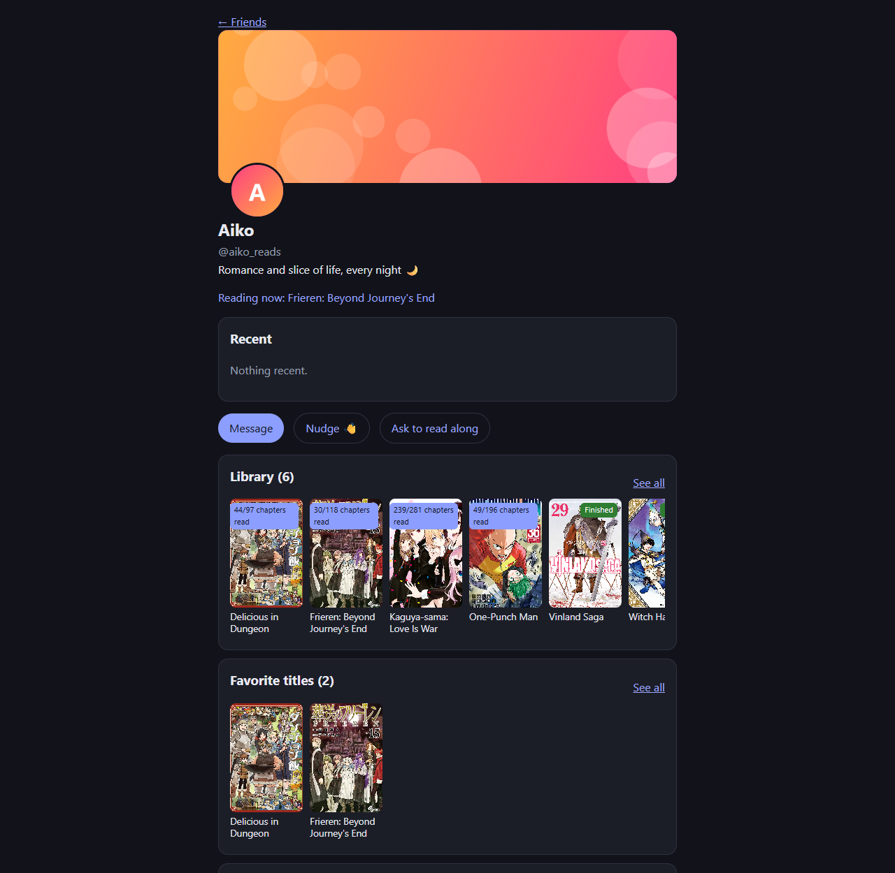 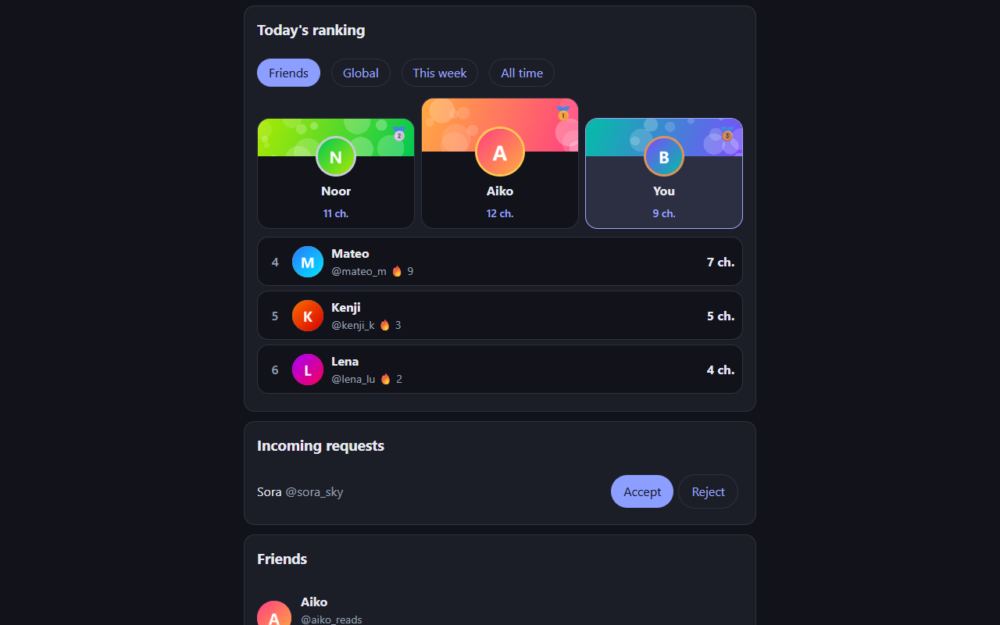 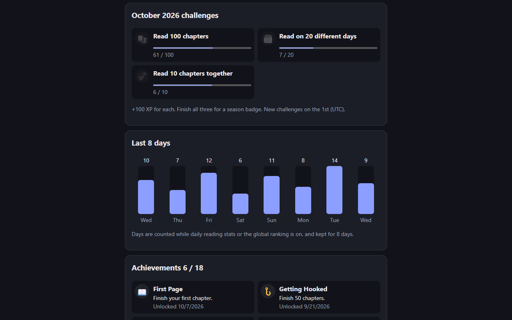

Screenshots use made-up demo accounts.

## Features

**Everything from Mihon:** local reading and downloads, a configurable reader, extensions, trackers (AniList, MyAnimeList, Kitsu, MangaUpdates and more), categories, backups and themes.

**Together:**

* **Friends:** add friends by handle or invite link, see who's online and what they're reading.
* **Read together:** rooms for up to 6 people; follow the host's page, chat, react, and use a ready check between chapters.
* **Chats:** private and group chats with emoji reactions, replies and title recommendations.
* **Friends who read this:** see which friends read a title and how far they got, even on another source.
* **Ratings and reviews:** rate titles out of 5 stars and see your friends' reviews.
* **Shared libraries and favorites:** browse your friends' libraries (covers included).
* **Rankings and XP:** levels, badges and streaks; friends, daily, weekly and all-time rankings.
* **Profiles:** avatar, banner, accent colour and bio.
* **Translation:** translate speech bubbles in the reader, with your own Gemini key or free on-device translation.
* **Discord status:** show what you're reading on your Discord profile (optional).
* **Website:** your friends, chats, libraries and rankings at [mihontogether.web.app](https://mihontogether.web.app).
* **My library on the web:** read your phone's library in your computer's browser. Pages go straight from the phone over an encrypted WebRTC link; nothing is uploaded.
* **Translate raws on your PC:** the [Mihon Together Translator](tools/koharu-bridge) runs [Koharu](https://github.com/koharu-rs/koharu) locally and turns Japanese, Korean and Chinese pages into English in the web reader. No keys, nothing uploaded.

**Privacy:** local reading works signed out and offline. You choose what friends can see in Privacy, invisible mode hides everything, and nothing is shared beyond your friends except the optional global ranking. See the [privacy policy](docs/PRIVACY_POLICY.md).

## Building

See [BUILDING.md](BUILDING.md). The social features need a Firebase project; debug builds use the local Firebase emulators, so you can try everything without one.

## Docs

* [Social API (backend contract)](docs/SOCIAL_API.md)
* [Read-together protocol](docs/READER_INTEGRATION.md)
* [Web library protocol](docs/WEB_LIBRARY_PROTOCOL.md)
* [Firebase setup](docs/FIREBASE_SETUP.md) and [production deploy](docs/PRODUCTION.md)
* [Translation](docs/TRANSLATION_PLAN.md)
* [What's new](docs/WHATS_NEW.md)

## Contributing

Pull requests and issues are welcome. Please read the [Code of Conduct](./CODE_OF_CONDUCT.md) and the [Contributing guide](./CONTRIBUTING.md) first.

## Credits

Mihon Together is built on [Mihon](https://github.com/mihonapp/mihon) and the work of its contributors, who in turn continue [Tachiyomi](https://github.com/tachiyomiorg/tachiyomi). Thank you!

## Disclaimer

The developer(s) of this application have no affiliation with the content providers available, and this application hosts zero content.

## License

<pre>
Copyright © 2015 Javier Tomás
Copyright © 2024 The Mihon Open Source Project
Copyright © 2026 Mihon Together contributors

Licensed under the Apache License, Version 2.0 (the "License");
you may not use this file except in compliance with the License.
You may obtain a copy of the License at

http://www.apache.org/licenses/LICENSE-2.0

Unless required by applicable law or agreed to in writing, software
distributed under the License is distributed on an "AS IS" BASIS,
WITHOUT WARRANTIES OR CONDITIONS OF ANY KIND, either express or implied.
See the License for the specific language governing permissions and
limitations under the License.
</pre>
