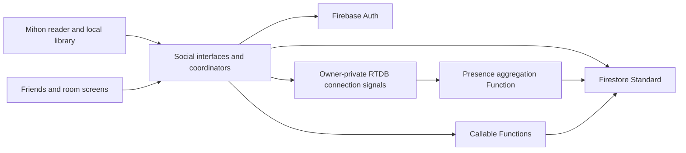

# Mihon multiplayer implementation plan

Prepared 2026-10-01 for the local checkout of `mihonapp/mihon` at `972c9d43da5eb6273f74d01fa48b778343818cc4`.

This is the historical preparation plan. At that checkpoint, the repository and skills were prepared, and no multiplayer code, cloud resources or APK had been created. The phases and initial decisions below preserve that planning context. Read [the implementation checkpoint](IMPLEMENTATION_CHECKPOINT.md), [local setup](MULTIPLAYER_SETUP.md) and the verification reports for current code, APKs, checks and release work.

## Product behavior

The fork adds accounts and accepted friends, online status, an opt-in current activity display, shared libraries, separate favorite titles, and invite-only reading together. Reading locally remains available without an account or network.

The first reading-room version supports two accepted friends. They can read independently or a guest can choose **Follow host**. Larger groups, chat, notifications, and automatic host transfer can follow after the two-person protocol works.

Library, favorites, current activity, online status, and last-seen have independent private/friends controls, initially private. Per-title hiding, remove friend, block, invisible mode, and source-specific incognito are part of the implementation. Reading together requires an explicit invitation and sharing consent.

Proposed hiding contract: a hidden title is absent from the shared library, shared favorites, and current activity. A deliberate room invitation can share it only after explicit room-specific consent; incognito still prevents room publication.

## Phase 0 — Documentation discovery and decisions

**Status:** research completed; native build readiness remains unverified. Two research agents inspected official Mihon and Firebase documentation; the local source was then checked at the exact imported commit.

### Existing patterns to reuse

| Concern | Verified local pattern | Integration direction |
| --- | --- | --- |
| Friends entry | `app/src/main/java/eu/kanade/tachiyomi/ui/more/MoreTab.kt`, `MoreTab.Content()`; `app/src/main/java/eu/kanade/presentation/more/MoreScreen.kt` | Add Friends through More initially; reuse the plain screen/state-holder split and Voyager navigation. |
| Dependency injection | `app/src/main/java/mihon/app/di/AppGraph.kt`; Metro annotations in `MoreViewModel` | Register app-owned social repositories/coordinators in Metro, matching current code. |
| Reader outgoing position | `app/src/main/java/eu/kanade/tachiyomi/ui/reader/ReaderViewModel.kt:481`, `onPageSelected(page: ReaderPage)` | Skip inserted/error pages; enqueue lightweight settled page events. |
| Reader incoming position | `app/src/main/java/eu/kanade/tachiyomi/ui/reader/ReaderActivity.kt:659`, private `moveToPageIndex(index: Int)` | Reuse the existing local page-resolution path after chapter loading. This helper is private; add an internal event bridge rather than calling it from an unrelated class. |
| Incognito | `app/src/main/java/eu/kanade/domain/source/interactor/GetIncognitoState.kt`, `await(sourceId)` and `subscribe(sourceId)` | Observe changes continuously so turning on incognito stops already-running social publishing. |
| Library membership | `domain/src/main/java/tachiyomi/domain/manga/model/Manga.kt:43`, `favorite` derives from `favoriteAt` | Create separate social favorites; do not reinterpret membership. |
| Library projection | `data/src/main/java/tachiyomi/data/manga/MangaRepositoryImpl.kt`, `getLibraryManga()` / `getLibraryMangaAsFlow()` | Read local metadata and construct a bounded sharing model. |
| Preferences and strings | `BasePreferences` uses `PreferenceStore`; strings in `i18n/src/commonMain/moko-resources/base/strings.xml` | Copy those conventions for social preferences and labels. |
| Build switches | `gradle/build-logic/src/main/kotlin/mihon/gradle/BuildConfig.kt` | Existing local distribution disables telemetry and updater; social Firebase initialization needs its own switch. |

`app/build.gradle.kts` currently gates both Google Services and Crashlytics plugins on `Config.includeTelemetry`. `telemetry/src/firebase/kotlin/mihon/telemetry/TelemetryConfig.kt` also has Mihon package/signing-certificate and GMS guards. Build a separate social initialization path rather than reusing upstream telemetry initialization for fork Auth/Firestore. The imported no-telemetry manifest declaration also contains a filename typo (`AndroidManifext.xml`); its target file is `AndroidManifest.xml`. Build impact is not yet verified.

The exact reader line locations above refer to the imported commit and may shift during implementation. Verify them again after updating upstream.

### Allowed Firebase APIs and examples

These are documented entry points to read before implementing the corresponding phase, not a complete implementation:

- Accounts: `Firebase.auth`, `createUserWithEmailAndPassword(email, password)`, `signInWithEmailAndPassword(email, password)`, `signOut()`. Copy the Kotlin examples in [Android Auth setup](https://firebase.google.com/docs/auth/android/start) and the installed auth skill's `references/client_sdk_android.md`.
- Realtime documents: `Firebase.firestore`, `DocumentReference.addSnapshotListener`, `ListenerRegistration.remove()`, snapshot cache/pending-write metadata. Use [Kotlin listener examples](https://firebase.google.com/docs/firestore/query-data/listen) and `firebase-firestore/references/standard/android_sdk_usage.md`.
- Atomic room writes: `FirebaseFirestore.runTransaction`; transaction callbacks can repeat and transactions fail offline. Read [transactions](https://firebase.google.com/docs/firestore/manage-data/transactions) before choosing the exact write contract.
- Presence: `Firebase.database.getReference(".info/connected")`, `addValueEventListener`, `connectionRef.onDisconnect().removeValue()`, `ServerValue.TIMESTAMP`. Copy the Android **Managing Presence**, **Detecting Connection State**, and **Sample Presence App** patterns in [Android offline/presence documentation](https://firebase.google.com/docs/database/android/offline-capabilities#managing_presence).
- Trusted social operations: `Firebase.functions.getHttpsCallable(name).call(data)`; copy the Kotlin client and server validation sections in [callable functions](https://firebase.google.com/docs/functions/callable).
- Backend presence bridge: use current Functions RTDB trigger examples in [database events](https://firebase.google.com/docs/functions/database-events), with the [Firestore presence solution](https://firebase.google.com/docs/firestore/solutions/presence) as the overall reference.
- Rules verification: `initializeTestEnvironment`, authenticated/unauthenticated contexts, `assertSucceeds`, `assertFails`, cleanup. Copy the current modular examples in [Rules unit testing](https://firebase.google.com/docs/rules/unit-tests).

Use Firebase's main Android modules (`firebase-auth`, `firebase-firestore`, `firebase-database`, `firebase-functions`) with the existing BoM/catalog conventions. Separate `*-ktx` artifacts are no longer maintained; see [Android library guidance](https://firebase.google.com/docs/android/learn-more#kotlin_extensions_ktx_library_modules). Resolve and verify dependencies before changing versions.

### Proposed architecture

This separation is an application design decision:

Firestore is the authority for friendship, blocks, visibility, shared metadata, and rooms. RTDB only holds owner-private connection signals. Functions publish derived status into Firestore; the mirror contains status, never permissions. Friends read status through current Firestore authorization, so delayed connection updates cannot grant access after a block.

Keep domain contracts provider-independent: `AuthRepository`, `FriendsRepository`, `SharedLibraryRepository`, `PresenceRepository`, and `ReadingRoomRepository` are proposed new interfaces. Their implementations live in the app/data boundary. Realtime listeners become cancellable flows; process/session coordinators own their lifetimes. Local SQLDelight remains authoritative for reading and personal progress.

### Proposed data boundaries

Finalize exact fields and query/index contracts in Phase 2 before authoring rules.

| Path | Data and authority |
| --- | --- |
| Firestore `/profiles/{uid}` | Bounded display name/handle; owner and accepted friends. Discover handles through a restricted callable rather than listing profiles. |
| `/accounts/{uid}` | Owner-only account metadata; no email/private fields in friend-readable documents. |
| `/sharingSettings/{uid}` | Separate visibility switches; owner controls, rules/functions consult. |
| `/friendRequests/{requestId}` | Sender, recipient, state; callable-managed acceptance and transitions. |
| `/friendships/{uid}/accepted/{friendUid}` | Reciprocal accepted edges, written atomically by trusted functions. |
| `/blocks/{uid}/users/{otherUid}` | Owner block state, consulted in both directions. |
| `/sharedLibraries/{uid}/entries/{contentKey}` | Selected library metadata only. |
| `/sharedFavorites/{uid}/entries/{contentKey}` | Independently shared social favorites. |
| `/activities/{uid}` | Current activity with expiry, no accumulated history in v1. |
| `/presence/{uid}` | Derived online state only; backend writes, owner/authorized friends read. |
| `/lastSeen/{uid}` | Separate visibility from online state; backend writes. |
| `/rooms/{roomId}` | Two participants, host, content descriptor, epoch, sequence, position, state and expiry. Membership/identity fields are server-owned. |
| RTDB `/connections/{uid}/{connectionId}` | Session/foreground connection signal; only its owner can read/write. |

Separate documents where visibility differs because Firestore reads cannot redact private fields inside an otherwise readable document. Rules and server functions check live reciprocal friendship, blocks, and the relevant visibility setting. Collection queries must fit those conditions; rules are not query filters. References: [field access](https://firebase.google.com/docs/firestore/security/rules-fields#allowing_read_access_only_for_specific_fields), [secure queries](https://firebase.google.com/docs/firestore/security/rules-query).

Confidence is high for verified code/API integration points, and provisional for the proposed room and content-matching protocol until emulator and device tests prove it.

## Phase 1 — Fork identity and reproducible baseline

**Depends on:** Phase 0; chosen app name/application ID; installed Android SDK.

**Implement:** set a distinct app name, application ID, and icon; disable the upstream updater or configure the fork's updater. Keep the internal namespace to reduce churn. Correct the no-telemetry manifest filename in `telemetry/build.gradle.kts`. Replace upstream Firebase configuration before enabling any Firebase SDK. Add an independent social inclusion/configuration path so Auth/Firestore can work with analytics disabled. Retain source attribution and license.

Copy the existing configuration patterns in `app/build.gradle.kts`, `BuildConfig.kt`, and the Moko base resources; follow [Mihon's fork requirements](https://github.com/mihonapp/mihon/blob/972c9d43da5eb6273f74d01fa48b778343818cc4/CONTRIBUTING.md).

**Verify:** run the environment script; then the wrapper commands in `FORK_SETUP.md`. Install alongside upstream Mihon and verify separate app data. Confirm updater and telemetry targets. Capture the baseline result before introducing social behavior.

**Guard:** do not enable upstream Firebase config, change dependency versions speculatively, or claim a successful APK build from a prerequisite check.

## Phase 2 — Local contracts and Firebase emulator boundary

**Depends on:** Phase 1. Can start with a clearly identified local demo project.

**Implement:** provider-independent social models/interfaces, disabled-by-default preferences, fake repositories for screen development, and a Firebase adapter selected explicitly. Define bounded fields and every query/index. Add a `backend/` workspace for rules, callable Functions, and emulator tests. Use Auth, Firestore Standard, RTDB, and Functions emulators under one project ID, configured before SDK access.

For Android emulators, copy the product-specific `useEmulator("10.0.2.2", port)` setup from official guides: [Auth](https://firebase.google.com/docs/emulator-suite/connect_auth), [Firestore](https://firebase.google.com/docs/emulator-suite/connect_firestore), [RTDB](https://firebase.google.com/docs/emulator-suite/connect_rtdb), [Functions](https://firebase.google.com/docs/emulator-suite/connect_functions). Typical default ports are 9099, 8080, 9000, and 5001; read the actual emulator configuration. Physical phones need a reachable development host address.

**Verify:** signed-out and offline local reading; adapters route only to the intended emulator; listener cancellation on account switch; denial for all unimplemented paths. Establish a Rules test runner from the documented modular examples.

**Guard:** fake UI data is not an online multiplayer implementation. Do not mix demo Auth with production data, copy admin credentials into Android, or infer Enterprise edition from the generic skill default.

## Phase 3 — Accounts, profiles, and accepted friends

**Depends on:** Phase 2.

**Implement:** email/password registration, sign-in, verification/recovery, logout, display name, and friend-code/handle lookup. Add send, accept, reject, cancel, remove, and block actions. Use authenticated callables for friendship transitions; only a recipient can accept. Acceptance writes both edges atomically. Backend functions validate identity, input sizes, and state transitions themselves because Admin SDK operations bypass client rules.

Copy Auth, callable, and transaction examples listed in Phase 0. Add Friends through `MoreTab` using the existing Metro ViewModel and plain Compose screen pattern. Keep account data separate from the profile.

**Verify:** two emulator accounts can request/accept friendship; a third cannot read private friend data. Test pending/one-sided edges, duplicate requests, wrong-recipient acceptance, forged ownership, block/remove, account switching, and query shapes. Test functions and Rules separately.

**Guard:** an authenticated user alone is not sufficient permission. Do not let clients manufacture accepted relationships, expose emails for discovery, or rely on the Android UI for authorization.

## Phase 4 — Shared library and separate favorites

**Depends on:** Phase 3.

**Implement:** a selected metadata projection, separate local social favorite state, private/friends sharing controls, per-title hiding, bounded paginated friend-library screens, and explicit unpublish/delete. Map canonical tracker IDs when available; otherwise retain a stable source/normalized chapter descriptor with explicit user binding. SQLDelight changes require migration verification.

Copy `getLibraryMangaAsFlow()` and existing preference/migration conventions. A projection can contain title, canonical identifier, selected source descriptor, and progress only when its visibility allows it. Exclude local notes/memo, credentials, paths, source cookies/tokens, backup contents, and chapter image payloads. Defer shared cover fetching if it needs authenticated source access.

Revocable metadata belongs in a cancellable application outbox, not Firestore's automatic offline write queue. Submit bounded projections through an online callable that validates the current server sharing generation as well as identity and payload; do not automatically replay failed uploads. Privacy changes cancel unsent app-outbox entries immediately. When reconnecting, synchronize revocation/generation changes before publishing new projections.

**Verify:** library membership and social favorites remain independent; private favorites stay private even with a shared library. Hidden/deleted entries disappear after server-confirmed retraction. Test authenticated stranger reads, block/remove while subscribed, oversize/extra fields, pagination, and offline opt-out. Reject a stale upload generation after revocation. Show pending retraction while offline: stopping local publication cannot immediately remove data that a friend can still fetch from the server.

**Guard:** avoid serializing `Manga` directly or equating local numeric IDs/title text with a globally unique work.

## Phase 5 — Online status and current activity

**Depends on:** Phase 3; activity title projection reuses Phase 4.

**Implement:** a process-owned presence coordinator. On foreground connection, allocate a unique connection ID and wait for server acknowledgement of `onDisconnect().removeValue()` before publishing a live node. Remove the node on background/logout/invisible changes. Aggregate all devices into Firestore with a retry-safe Function. Publication needs fencing/serialization, not just a fresh RTDB read: read the destination status inside a retrying Firestore transaction, reread current RTDB state inside each transaction attempt, and publish from that attempt. Do not trust an old trigger payload or let an earlier read finish last and overwrite a newer status. Preserve monotonic last-seen and update it for an all-devices-offline transition rather than any single disconnect. Keep an authorized non-`.info/connected` listener during the foreground session as required by the Android presence guidance.

Publish bounded current activity separately from online/last-seen state. Observe `GetIncognitoState.subscribe(sourceId)`, per-title hiding, visibility changes, and account changes. Incognito suppresses reading details and room publication; the user can still separately control generic online presence. Expire activity and display uncertain/stale status instead of presenting it as live.

On incognito or sharing opt-out, suppress locally at once; when online, clear published activity and close/leave the active room. While offline, show server retraction as pending and let the bounded activity/room expiry limit stale visibility. Canceling a listener or an app coroutine cannot undo a server write that already committed.

**Verify:** two devices on one account, one-device disconnect, process kill, airplane mode, background, reconnect, invisible mode, incognito changes, Function retries/out-of-order delivery, and access revocation while subscribed. Force an earlier RTDB read to complete its publication after a later read, and prove the final mirror converges to current state without regressing last-seen. Test permission denial for another user's raw RTDB signals. Treat disconnect detection and status mirroring as asynchronous.

**Guard:** a network socket does not mean someone is actively reading. Do not copy friendship ACLs into RTDB or publish stale activity on reconnect.

## Phase 6 — Read together

**Depends on:** Phases 3–5 and proven content/chapter mapping.

**Implement:** invite/create/accept/leave/close a two-person room through callables. Identities, membership, host and epoch are server-owned. Room access checks current accepted friendship and both block directions. V1 ends the session when the host closes/leaves; host transfer is deferred.

Give each host room writer one in-flight transaction and a single pending slot holding the latest settled position. Coalesce newer turns into that slot while a transaction runs. An online transaction checks active room, current epoch and current sequence, then advances sequence by exactly one. Reconcile transient failures against fresh authorized server state before submitting the current pending position. Cancel and discard it on account/privacy/epoch changes or denial. Keep transaction callbacks free of UI effects so retries cannot send a second reader command. This prevents overlapping old turns from publishing after newer turns.

Guests listen and can select Follow host; remote movement waits for compatible chapter readiness and suppresses outgoing echo. Reconnect consumes the latest authorized server snapshot rather than replaying queued turns; cached/pending-write state must not drive follower navigation.

Bind the server-owned host lease to one host connection/session, including for two devices on the same account. Proposed pilot defaults are a foreground host renewal every 30 seconds and a 90-second server-assigned expiry; tune with measured traffic. Renew through an authenticated callable, and check unexpired lease against server time in every room Rules/function operation. A disconnected/stale host freezes following and shows a waiting state. At expiry the room ends; reconnect requires a fresh server-approved session. Eventual TTL deletion is cleanup, not the authority for expiration. There is no automatic host transfer in v1.

Use the local `onPageSelected` hook and the private `moveToPageIndex` pattern described in Phase 0. Each device retrieves its own chapter. Exact page following requires an explicitly matched edition/source/chapter and page mapping. Equal page counts alone do not prove compatibility; chapter-level coordination and a visible mismatch/rebind state are the fallback.

**Verify:** two devices read one matched chapter, independently and with following. Test missing source/chapter, different edition/page mapping, duplicate/out-of-order snapshots, stale epoch, follower host impersonation, invalid positions, block/remove, incognito mid-room, host crash and lease expiry, offline/reconnect, rapid turns, and competing devices on one host account. Prove the last settled turn wins after overlapped input and retries. Validate host transaction Rules with the same queries and payloads used by Android.

**Guard:** never send manga images/source credentials, apply remote page indexes blindly, queue stale room writes offline, or turn a remote jump into an echo loop.

## Phase 7 — Verification and pilot release

**Depends on:** all implemented feature phases.

**Verify implementation against docs:** review the actual SDK signatures, listener cleanup, edition, emulator configuration, Rules queries, and fork identity. Run the independent Rules auditor; resolve findings with emulator regression cases. Look for unintended `firebase-*-ktx` dependencies, raw `Manga` uploads, broad authenticated reads, unowned coroutine scopes, and missing cancellation.

**Native checks:** `spotlessCheck`, `testDebugUnitTest`, `verifySqlDelightMigration`, debug assembly, then release assembly and relevant instrumented tests. These tasks come from [upstream CI](https://github.com/mihonapp/mihon/blob/972c9d43da5eb6273f74d01fa48b778343818cc4/.github/workflows/build.yml); keep fork telemetry/updater flags intentional rather than copying `-Pdist=ci` blindly.

**Backend checks:** unauthenticated/unrelated/pending/accepted/blocked/private access matrix; both create/update validation; callable ownership and retries; presence aggregation; listener revocation; room state consistency. Rules coverage is evidence for tested cases, not a guarantee of exhaustive security.

**Device checks:** two Android devices with real sources plus multi-device/account switching, background/process-death, low bandwidth, consent changes and mismatched editions. Friends' social data should use memory-only caching in v1 where supported; cancel subscriptions and discard app-held data on logout/revocation. Authorization cannot erase information a recipient already viewed.

**Pilot readiness:** choose the production Firebase project/location, actual database edition, signing identity, distribution-appropriate App Check settings, retention/account-deletion behavior, and update destination. Implement account deletion across Auth, reciprocal friendships, shared metadata, room membership and raw/derived presence. Inspect measured room-write/listener traffic and billing before increasing participation: Firestore listeners and Rules dependency reads contribute to usage ([billing reference](https://firebase.google.com/docs/firestore/pricing)).

## Checkpoint handoffs

Each phase should leave a short record of files changed, documentation used, behavior demonstrated, checks passed, limitations, and next dependencies. Phase 4's library work and Phase 5's presence work can proceed in parallel once Phase 3's authorization contract is stable; reader-room integration waits for both.

The next implementation task is Phase 1 followed by Phase 2. App name/application ID and SDK setup are the first missing inputs. GitHub origin and a production Firebase project can be selected later; local emulator work does not require a production deployment.
